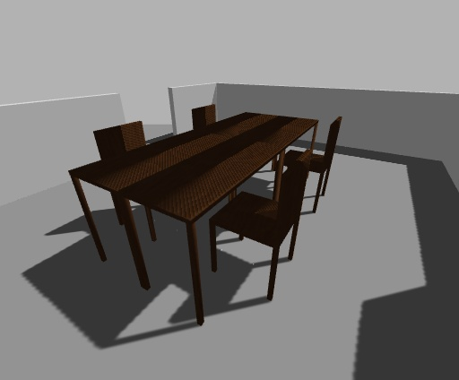

# Home VLN

ROS 2 household language navigation with online semantic mapping and visual inspection.

家庭场景语言导航与视觉检查，基于 ROS 2 Humble、WPB Home、在线 SLAM、YOLOE 和 Nav2。支持依次寻找 **沙发、茶几、餐桌、椅子**，到达附近并按需检查桌面或座面；不预置地图、家具坐标或观察点。

下列命令均在项目根目录执行。

```text
激光 + odom → 在线地图 ───────────────┐
RGB-D → YOLOE 分割 → 对象语义图 ────┼→ 探索 / 动态停靠 → Nav2
语言指令 → 顺序目标与检查问题 ───────┘              ↓
                                      到达复核 → 完整取景检查 → 回复
```



## 配置与构建

需要 Ubuntu 22.04、ROS 2 Humble、Gazebo Classic 11 和 Conda；系统依赖与 CPU 配置见[安装说明](docs/IMPLEMENTATION.md#安装与配置)。ROS 使用系统 Python，YOLO 使用独立环境 `yolo`，默认使用 NVIDIA GPU。

```bash
conda env create -f config/environment.yml  # 已有匹配环境可跳过
bash scripts/setup_tf2.sh
bash scripts/setup_local.sh --assets-from /模型资源目录
cp -n .env.example .env.local
```

模型目录需包含 `yoloe-26m-seg.pt` 和 `mobileclip2_b.ts`，[官方下载地址及哈希](config/model_assets.json)。在本机编辑 `.env.local` 填写可用的千问 API Key；默认视觉模型见 `config/model.env`。

```bash
bash scripts/build.sh
bash scripts/test.sh
```

## 启动与任务

终端一，使用 ROS 2 launch：

```bash
source scripts/env.sh
ros2 launch home_explore bringup.launch.py
```

也可用等效快捷命令 `bash scripts/run_all.sh`；脚本准备相同环境后调用上述 launch。

终端二：

```bash
bash scripts/vln.sh run '先到沙发附近，再到餐桌附近，最后检查餐桌上有什么。'
```

|操作|命令|
|---|---|
|自主探索|`bash scripts/vln.sh explore`|
|状态 / 结果 / 取消|`bash scripts/vln.sh status` / `result` / `cancel`|
|相机 / 分割 / 检查图|`bash scripts/view_camera.sh`，追加 `detections` 或 `inspection`|
|保存几何地图|`bash scripts/save_map.sh`|
|导出源码包|`/usr/bin/python3 scripts/package_code.py`|

运行记录在 `results/`；打包脚本生成项目上一级的 `home_vln_source.zip`，排除凭据、权重和构建缓存。

## 文档

- [实现与代码导读](docs/IMPLEMENTATION.md)：架构、算法、接口和配置。
- [验证记录](docs/VALIDATION.md)：实际构建、测试、仿真结果及复现边界。
- [来源与许可](docs/REFERENCES.md)：场景、模型、依赖和论文。

当前为对象目标导向语言导航原型，借鉴 VLFM 与 L-SNI 部分思路，尚未接入 VLFM 语言价值地图。限单层仿真；预训练识别仍有波动，语义图记录已见部分表面。
