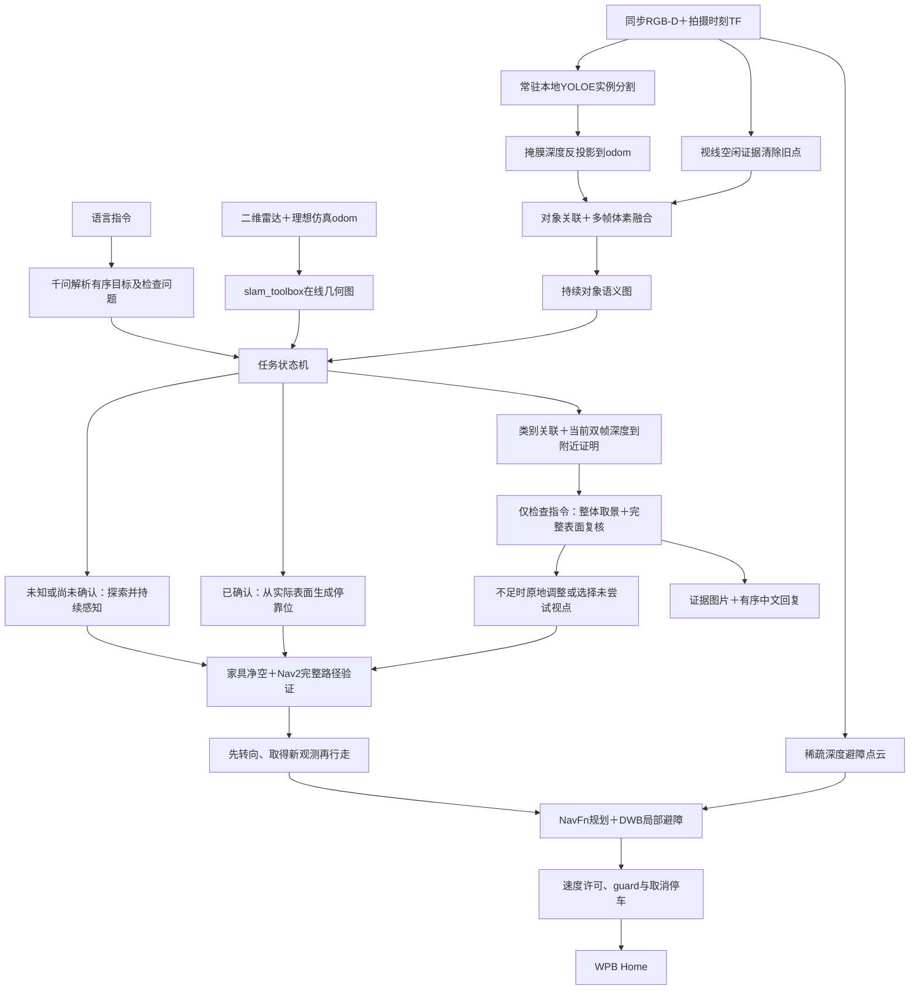

# Home VLN 实现说明

## 1. 功能、路线与边界

理解有先后顺序的家具目标指令，在未知单层家庭中自主搜索、到家具附近，并按要求检查最后目标的桌面/座面。当前支持sofa、tea_table（coffee table）、dining_table、chair，最多五个顺序目标。本项目使用阿杰原始WPB Home轮式机器人。运行不读取家具真值、先验地图或固定观察点。

总路线为**VLFM启发的探索＋L-SNI启发的RGB-D对象建图与停靠**。VLFM原作利用视觉语言价值地图选择前沿；本项目当前实现在线几何前沿、实际相机覆盖和对象发现中断，尚未实现BLIP-2稠密语言价值图。L-SNI原作把LiDAR投到语义掩膜，本项目用对齐RGB-D反投影，并借鉴对象周围生成停靠候选的思想，未复现原论文梯度评分。当前为对象目标导向语言导航原型。

## 2. 架构



**几何建图和语义建图独立于语言任务生命周期。** 几何图由slam_toolbox维护；语义融合是agent节点中的独立常驻线程，并非额外的语义ROS节点。任务完成/取消只停止运动，不停止本地感知。云端理解或检查等待时，语义线程仍处理新帧。

## 3. 技术栈与桥接

|部分|实现|
|---|---|
|平台|Ubuntu22.04、ROS2 Humble、Gazebo Classic11、WPB Home家庭仿真|
|建图定位|slam_toolbox在线2D SLAM；planar_move提供理想仿真odom，非真实轮式动力学|
|导航|Nav2 NavFn/Dijkstra、DWB、激光/深度障碍层、碰撞检查Spin|
|连续感知|Conda环境yolo、YOLOE-26m-seg、原分辨率实例掩膜，无训练|
|语义几何|OpenCV、NumPy、SciPy、TF2、10cm对象体素、多帧重叠关联|
|云端|默认qwen3-vl-plus：语言解析、有限本地漏检补查、最后检查|
|控制桥接|ComputePathToPose、NavigateToPose、Spin Action；速度租约与guard|

ROS使用系统Python3.10；YOLO独立Conda进程通过带请求ID的JSONL通信，不加载ROS。请求锁防止连续建图和到达复核争用worker；迟到响应不会混入新请求。千问不直接生成速度。

## 4. 两张地图怎样形成和更新

### 4.1 在线几何图与代价地图

二维雷达和odom输入slam_toolbox，形成`/map`和map→odom变换，配置地图发布间隔1秒。Nav2另维护障碍/膨胀代价地图，局部更新10Hz、全局2Hz，接受实时雷达与RGB-D稀疏障碍点云。几何占用图、Nav2代价图和对象语义图是不同数据结构，不能把三者写成同一地图。

### 4.2 从当前图像到对象表面

相机RGB与对齐深度为512×424，水平视野90°，实际内参由CameraInfo提供。对掩膜中有效深度像素：

```text
p_camera = [(u-cx) * z/fx, (v-cy) * z/fy, z]
p_odom = R_odom_camera(capture_time) * p_camera + t_odom_camera(capture_time)
p_map = T_map_odom(current) * p_odom
```

`surface_geometry()`对掩膜边缘腐蚀、无效深度/高度和前表面深度带过滤，输出可见支持点。点保存在odom，展示、导航候选通过当前TF投到map。使用拍摄时刻的TF，而不是收到云回答时的机器人位姿。没有输入3D LiDAR，也没有DBSCAN或完整物体重建。

### 4.3 常驻的多帧融合流程

1. 每轮取得比上一轮更新、时间戳有效且有对应TF的RGB-D；本地YOLO分割当前四类家具。名义处理间隔0.5秒，实际周期还包含推理与同步耗时。
2. 同类别检测与历史对象三维支持点比较；在2倍体素边长内计算重叠，重叠足够则关联。单帧内一个历史ID只能分给一个检测，减少相邻实例被直接合并。
3. 按10cm三维体素融合，每帧每体素只投一票。像素更多、重复提交同一时间戳，都不能假装获得多次观测。
4. 单体素至少获得两个独立时间戳的支持；对象至少有20个这样的体素后为`confirmed`，否则为`tentative`。分辨率、次数、数量均在behavior.yaml显式配置，取决于传感器噪声与采样密度，不依赖房间坐标。
5. 已确认对象使用稳定体素更新代表点、范围、观看参考和最多600个支持点。空间体素等权，避免对一个角落反复拍照把整个家具位置拖过去。代表点是**已见表面的均值**，观看参考是已见包围盒中部，均非完整物体真中心。
6. 每轮用实际深度检查旧点。仅当投影视线的三个不同时间戳的新深度明显位于旧点之后，才将旧点清除；与旧点接近的深度会重置反证计数，更近的遮挡、无效深度、视野外和一次漏检不构成清除依据。清空的对象为`cleared`，不再当目标。
7. 发布轻量`/vln/semantic_map`、体素markers、分割图和建图健康状态，同时原子保存会话地图。没有任务时只保留最新帧/地图，活动任务保存详细图片、掩膜和深度证据。

对象记忆在一次仿真的多个任务间复用；重启仿真后重新在线建图，不加载旧运行地图。

这与代价地图相似之处是持续接收新证据并更新，不同之处是语义地图存储对象身份、类别与部分表面，而代价图存储导航代价。重复观测减轻随机误差，但同一个YOLO系统性误分类、深度偏差或TF偏差不会因多投几票自动变正确。当前没有跨类别概率融合、完整位姿图重积分和动态物体运动模型。

## 5. 任务流程与停靠

```text
语言解析为有序目标
    ↓
查询持续语义图
    ├─ 无已确认目标 → 选择未观察方向/在线前沿，导航时持续分割和融合
    └─ 已确认目标 → 锁定实例，从已见表面动态生成近侧安全停靠位
                             ↓
                 Nav2完整路径与家具净空验证
                             ↓
                  先看后走 → 当前双帧到达复核
                             ↓
            只到附近：下一目标/结束；要求检查：进入完整取景检查
```

探索不使用预设观察点：`grid.py`提取自由/未知边界，结合路程、前沿大小和重复访问；`coverage.py`另记录相机实际看过的区域，墙阻断视线，激光扫到但相机未看过的地方仍可观察。发现已确认目标可中断探索，切换对象接近。当前尚无VLFM原作的语言价值图。

首次沿初始odom朝向生成前进候选，验证正前方路径后执行；没有安全通路则停车。可设置`entry_forward_distance: 0`关闭此策略。

`Grid.docking()`沿已见表面每10°生成外侧候选，默认近处间距0.75/0.9/1.0m。朝向对准融合后的观看参考，不追一个边角。候选先做已确认家具XY凸包排除，再空间去重；随后调用ComputePathToPose验证路线，优先短的实际可达路径。已确认家具净空0.32m来自圆形底盘半径和余量。语义几何不直接注入Nav2图层，执行时的实时避障仍依赖Nav2雷达/深度。

到点实测仍偏远时，沿已验证路线减小距离；无直接停靠位时选择有进展的中间点。资源边界为任务1800秒、每步骤60次决策、检查120秒、云请求32次，均可配置；无可用候选或安全路径时停止。

## 6. 附近到达与完整检查的不同判据

### 6.1 “到家具附近”

优先当前YOLO类别、分割掩膜和历史支持投影关联；本地缺失才有限云端补查。取得两个不同时间戳的当前深度观测，要求机器人静止、测距几何一致。用掩膜支持点到底盘XY距离的10%分位数，两帧取较大值，配置附近范围为`0.5m < d <= 1.25m`。无掩膜的补查用框内深度连通生长，不按历史距离筛选出期望答案。

**附近验收允许偏心和局部裁剪，以当前类别关联与双帧距离为依据。** 出发前观察和到点朝向调整负责取得可辨认的画面。

### 6.2 “检查家具上有什么”

先判断当前画面，合格立即完成。必须同时满足：家具整体外轮廓在图像边缘内（无需看到背面/天然隐藏桌腿）、整个指定桌面/座面可见、没有墙/扶手/靠背等遮挡，模型给出可信的目标框、表面透视轮廓和实际物品描述，程序再检查坐标、边界、面积与三维目标关联。

若画面裁剪但无遮挡，根据实际目标框尝试原地调整；若遮挡或站位不足，从已见表面生成未尝试新视点，用相机内参预测入镜比例，综合路程和视角新颖性，经真实路径验证再移动。曾经试过的近似位置/朝向被排除，避免原地来回重复同一照片。

多帧语义几何提供候选依据，**不代表最终照片已经完整**。完整性最后依据实际当前RGB；看不全不能说“整面为空”。成功保存inspection.jpg/json并直接回复，不返回旧停靠点重新到达。若物理上不可观察、无安全新视点或预算耗尽，明确`FAILED`、停车并保留缺失证据，不能用“不确定”冒充已完成检查。

## 7. 新鲜度、安全与ROS接口

RGB-D使用真实时间戳和拍摄时TF；深度障碍点云可靠接收深度后每4像素采样，BEST_EFFORT输出。启动等导航激活、TF和障碍点云健康；持续断流撤销速度租约并取消动作。TF2旧版本的锁顺序问题用本项目校验后的0.25.24库处理，不升级系统，复现见setup_tf2.sh。

出发前重新确认完整路径，转向目标/路径方向并取得新观测，再NavigateToPose前进。DWB和guard禁止负vx，Spin带碰撞检查。语义轮廓轻微变化不反复取消同一导航目标。

|接口|含义|
|---|---|
|/scan、/odom、/map|几何建图输入与输出|
|/camera/image_raw、/camera/depth/image_raw、/camera/camera_info|对齐RGB-D和实际内参|
|/camera/obstacle_points、/vln/obstacle_cloud/status|实时障碍点云/健康|
|/vln/semantic_map|odom坐标对象图，包含版本、状态、支持点与体素数量|
|/vln/semantic_map/status|处理帧数、地图版本、确认对象数、最新帧龄/错误；等待/终态仍更新|
|/vln/markers、/vln/perception/image|融合体素、目标/候选与分割图|
|/vln/instruction、/vln/status、/vln/result、/vln/cancel|指令、进度、结果与取消|
|/vln/inspection/image|保留最新成功完整检查帧|
|/compute_path_to_pose、/navigate_to_pose、/spin|路径/导航/转向Action|
|/vln/cmd_vel_raw → guard → /cmd_vel|唯一速度出口及租约保护|

`processed_frames`表示处理过新相机帧，不表示发现新物品；`map_version`表示对象证据更新，并非SLAM地图版本。视野无家具时可处理很多帧而对象图仍为空。`confirmed`表示多帧表面支持，不表示全物体可见。

## 安装与配置

面向 Ubuntu 22.04 amd64，先安装 ROS 2 Humble 与 Conda，再补齐依赖：

```bash
sudo apt install ros-humble-navigation2 ros-humble-nav2-bringup ros-humble-slam-toolbox \
  ros-humble-gazebo-ros-pkgs ros-humble-robot-state-publisher ros-humble-rmw-cyclonedds-cpp \
  ros-humble-cv-bridge ros-humble-rviz2 python3-colcon-common-extensions \
  python3-numpy python3-scipy python3-opencv python3-yaml git
```

在 `home_vln/` 根目录按 README 创建 `yolo` 环境、准备两个官方模型文件，再执行配置、构建与测试。`environment.yml` 锁定核心依赖，未锁定全部间接依赖。`setup_local.sh` 检查版本、设备和模型 SHA256；保留已有环境，不自动下载权重。

- Conda 不在默认位置：`export YOLO_PYTHON=/绝对路径/envs/yolo/bin/python` 后执行配置。
- 使用外部凭据：`bash scripts/setup_local.sh --assets-from /模型目录 --credentials-file /凭据文件`；只记录路径。百炼接口使用北京地域凭据，所选模型需支持图片输入。
- CPU：在 `config/yolo_scene_classes.yaml` 设置 `device: cpu`；GUI 软件渲染可设置 `LIBGL_ALWAYS_SOFTWARE=1`。默认模型不随设备自动切换。
- `setup_tf2.sh` 在项目内安装兼容的 TF2 修复库；不升级系统包。直接 `ros2 launch` 也会检查该库。
- 默认 ROS 域65、Gazebo端口11385；先退出占用同端口的旧场景。独立测试使用域66、端口11386。

```bash
source scripts/env.sh
ros2 topic echo --once /vln/semantic_map/status
/usr/bin/python3 scripts/integration_test.py --cloud --seconds 360 \
  --instruction '先到沙发附近，再到餐桌附近，最后检查餐桌上有什么。'
```

`processed_frames` 应持续增长；初始视野无家具时对象为0正常。省略 `--cloud` 可验证自主探索及取消，不调用云模型；增加 `--gui --rviz` 可检查图形界面。完整语言与检查任务需要本机有效的云端凭据和网络。

`run_all.sh` 先加载 `env.sh`，再执行 `ros2 launch home_explore bringup.launch.py`。因此也可先 `source scripts/env.sh` 后直接 launch；仅加载 ROS 系统环境不包含本项目的模型、凭据、ROS 域与 TF2 配置。

## 代码导读

源码位于 `src/home_explore/home_explore/`；按以下执行顺序阅读：

|步骤|入口|主要职责|
|---|---|---|
|启动|`scripts/env.sh` → `launch/bringup.launch.py`|环境隔离、场景、SLAM、Nav2及应用节点|
|输入|`robot_io.py:capture()`|同步 RGB-D、内参与拍摄时刻 TF|
|感知|`agent.py:perception_loop()` → `yolo_client.py` / `yolo_worker.py`|常驻本地分割及 ROS/Conda 桥接|
|对象图|`semantic.py` → `voxel_fusion.py`|反投影、对象关联、多帧融合和空闲证据清除|
|任务|`cli.py` → `agent.py:run()/plan()`|解析并依次执行目标|
|搜索|`agent.py:decide()` → `grid.py` / `coverage.py:coverage_candidates()`|前沿与相机覆盖候选、可达路径排序|
|接近|`grid.py:docking()` → `robot_io.py:navigate()`|动态停靠、先看后走、Nav2动作|
|验收|`arrival_policy.py` → `inspection.py`|当前双帧到附近证明、完整表面检查|
|回复|`task_result.py` / `guard.py`|有序中文结果、取消与终态停车|

`covered` 是历史视线在当前二维地图上的估计覆盖，不等于识别充分。它通过新增可见区域收益参与搜索排序；当前未针对漏检实现观察质量分级或主动复查概率图。具体探索权重为工程启发式，未做跨环境最优性验证。

连续语义图保存在 `results/semantic_session_时间/`，任务目录保存图像、深度、事件、地图快照和结果。
