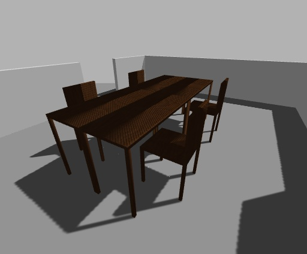
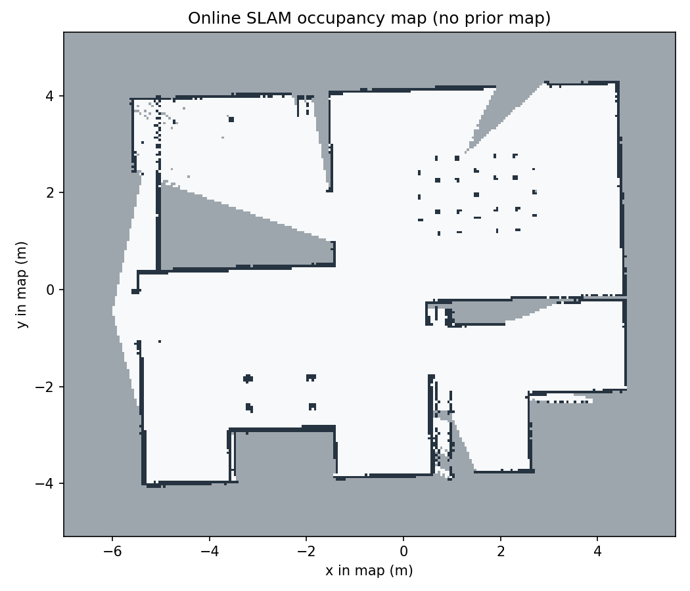
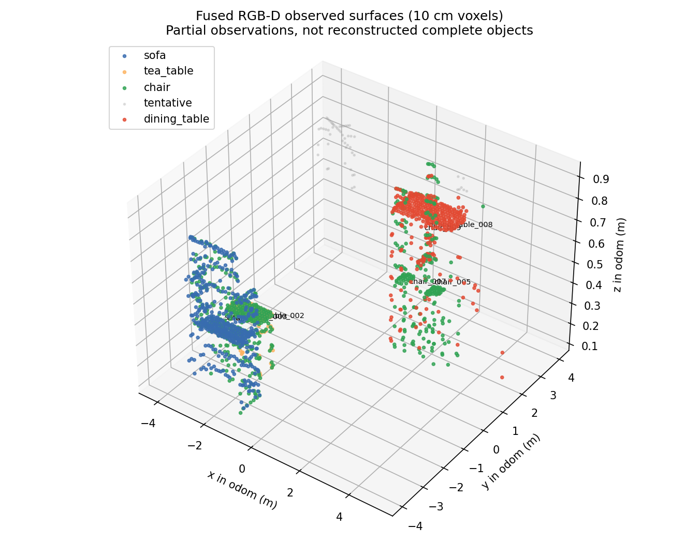

# 验证记录

## 验证环境与方法

Ubuntu 22.04、ROS 2 Humble、Gazebo Classic 11；系统 Python 与独立 `yolo` 环境。2026-11-12 从源码包解压，重新下载并校验 TF2 0.25.24，复用已安装的 ROS/Conda 依赖及已校验模型，独立构建两个 ROS 包；224 项回归通过。

使用独立 ROS 域66、Gazebo端口11386验证，启用 Gazebo GUI 与 RViz。直接 `ros2 launch` 完成“先沙发、再餐桌、检查餐桌”：103.4秒、仿真 odom 路程8.22米，完整检查无需换位。平移前观察、无负向前进速度、终态停车及持续语义建图检查均通过。

## 代表任务（2026-11-09）

从源码包解压到独立工作区，复用本机已安装的 ROS/Conda 环境、已校验模型和 TF2 库，独立构建两个 ROS 包；224 项回归通过。Gazebo 与 RViz 实际启动，未使用旧工程源码或 install。

|实际指令|墙钟|仿真 odom 路程|结果|
|---|---:|---:|---|
|先到沙发附近，再到餐桌附近，最后检查餐桌上有什么。|90.9秒|7.96米|成功|
|先到茶几附近。|334.0秒|17.62米|成功|

餐桌检查完整入镜，无需检查换位。茶几任务停靠7次、耗时较长，目标识别与复核仍有效率限制。每次平移前取得新观测；未检测到负向前进速度，终态速度为零、运动许可关闭，语义建图继续更新。

以下为2026-11-08同一实现路线的历史代表图：

## 复现边界

已验证本机软件环境下的源码复现，未重装操作系统或从零安装全部依赖。模型权重和凭据不随源码分发，需按 README 配置；云端任务另需网络及模型访问权限。

有限单场景任务不代表统计成功率。预训练误分类、深度或TF偏差仍可能影响结果；语义图为部分表面，完整检查依赖当前图像与模型判断。未进行实机、多楼层或跨场景评估。

2026-11-12 的仓库与报告材料整理仅调整文档、忽略规则和本地版本管理，运行算法与上述实测一致。
